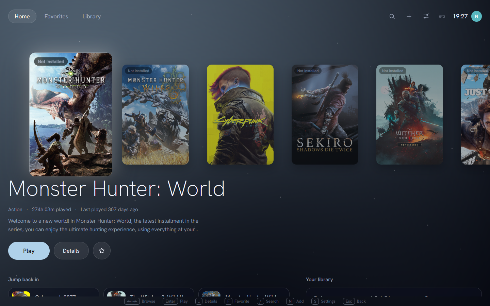
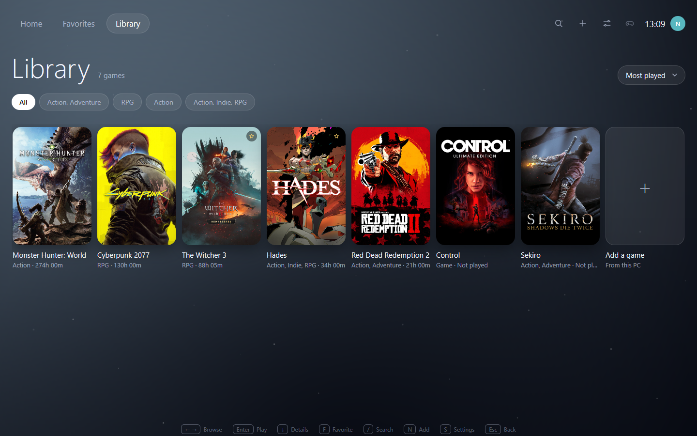
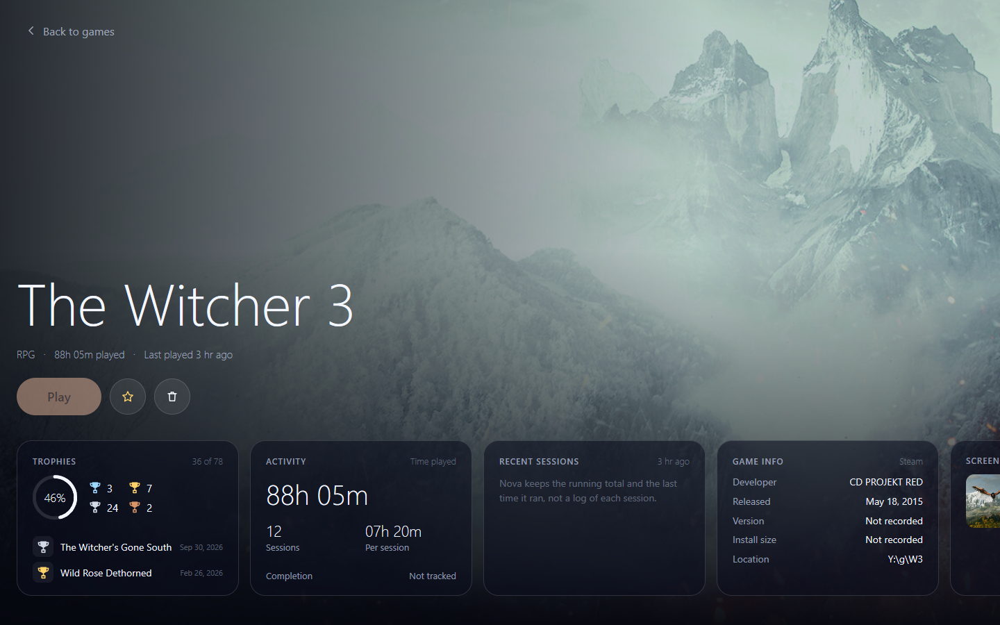
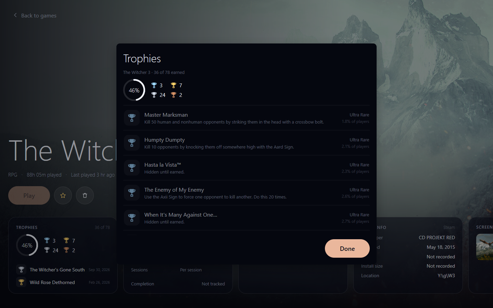

# Nova

A native Windows **game launcher**. It lists the games on your machine and starts
them.



Nova reads Steam's app manifests, scans any games folder you point it at, and
picks up the games you add by hand. Each one gets the cover, description and
screenshots Steam publishes, and the window takes its colour from the artwork you
select.

Nothing here is bought or downloaded, and no account is needed. Nova lists what you
have and runs it. It does not mod, patch or inject into a game.

Built with [MyGo](https://github.com/egoist/mygo): native UI, no web view, no
bundled runtime.

## What it does

- **Finds your games.** Nova reads Steam's `appmanifest_*.acf` files and scans any
  folder you add for executables. Steam's redistributables and tools get skipped.
- **Adds the game a scan misses.** Point it at a repack's folder, then give it a
  name, genre, description and cover colour. The executable path stays relative to
  that folder, so moving the folder keeps the entry working.
- **Shows Steam's artwork.** The cover, the store description, the screenshots and
  the 16:9 store backdrop. Fetched once, cached on disk.
- **Takes the game's colour.** The accent, the focus ring and the backdrop glows
  sample the selected cover, so the window changes when you change game. The
  backdrop cross-fades over one second.
- **Keeps play time.** Hours and sessions per game. Nova also imports the totals
  from Steam's own config, so a first run shows real hours instead of zeroes. It
  merges those as `max`, so an import cannot count the same hour twice.
- **Shows achievements.** With a Steam Web API key, a game's full list, with each
  achievement's rarity and the date you unlocked it.
- **Starts the game.** One click, from the game's own folder, with no console
  window.

## Screenshots

| Library | Game page |
|---|---|
|  |  |

Each game is a card you can open. Open one and you get a strip: achievements,
activity, game info, screenshots and the store description, laid over the game's
own full-bleed artwork.



## Running it

```
go build ./...
go run .
```

Develop with live reload:

```
go tool mygo dev
```

## Requirements

- **Windows 10 or newer.**
- **Go 1.27 or newer.**
- **The MyGo checkout.** `go.mod` points at a sibling folder:

  ```
  replace github.com/egoist/mygo => ../mygo
  ```

  Clone [`egoist/mygo`](https://github.com/egoist/mygo) next to this repository
  and the build works. Point the `replace` at wherever you keep it.
- **Optionally, Steam.** Without it the launcher reads only the folders you add.
  The achievement list also needs a free
  [Steam Web API key](https://steamcommunity.com/dev/apikey).

## Where your data lives

Everything this app writes goes to `%APPDATA%\nova\`:

| File | Holds |
|---|---|
| `library.json` | the extra folders to scan, the games added by hand, the games you removed |
| `stats.json` | time played and sessions, per game |
| `covers\` | the cover art, cached |
| `store\` | store descriptions, artwork and achievements, cached |

Nova reads Steam's files and writes none of them: `config\loginusers.vdf` for the
accounts, `userdata\<id>\config\localconfig.vdf` for play time.

The Steam API key does not go in that folder. It goes to the system credential
store: Windows Credential Manager, the macOS Keychain, or Secret Service on Linux,
through `mygo.Secrets`. Nova sends it to Steam and nowhere else.

## Keyboard

| Key | Does |
|---|---|
| ← → | choose a game |
| Enter | play it |
| ↓ | open its page |
| Esc | go back |
| / | search |
| F | favorite |
| N | add a game (pick its folder) |
| S | settings |
| 1 2 3 | Home / Favorites / Library |

## Data model

`library.json` holds the folders to scan and the games added by hand:

```json
{
  "folders": ["Y:\\games"],
  "manual": [
    {
      "dir": "Y:\\games\\Hollow Grove",
      "exe": "Binaries\\Win64\\HollowGrove.exe",
      "name": "Hollow Grove",
      "genre": "Exploration",
      "description": "A quiet forest that rearranges itself when you look away.",
      "hue": 150
    }
  ]
}
```

`exe` stays relative to `dir`, which is why moving a game's folder does not break
its entry. Nova skips an entry whose folder or executable has gone, rather than
showing a tile that cannot start.

## How it works

- **`internal/library`** finds installs from Steam manifests, a folder scan and the
  games you added by hand. An install is a manifest or folder plus an executable. A
  Steam tool or a redistributable does not count as a game.
- **`internal/steam`** reads Steam. The store page, the account's play time from its
  own config files, the owned-games list and the achievements all live here, each
  cached on disk with an expiry.
- **`internal/app`** is the whole interface. `home.go` holds the carousel, `hub.go`
  the game page, `library.go` the grid, `art.go` the generated artwork, and
  `theme.go` the palette.

## Known limits

- **Steam folders without `appmanifest_*.acf` are invisible.** No manifest means no
  app id, and Nova does not guess one. Add the folder by hand instead.
- **Games that need the Steam client running must start it themselves.** A fix I
  have not built: `steam://rungameid/<appid>` as a fallback when a launch fails.
- **Tiles are 2:3.** Steam publishes no square asset. Its portrait covers are
  exactly 2:3, so the tile matches the art and nothing gets cropped.
- **Achievement tiers come from rarity.** Steam has no bronze, silver, gold or
  platinum; that is a PlayStation concept. A tier here means how few players hold
  the achievement, worked out from the percentages Steam publishes.
- **Some store pages open with marketing** before they describe the game. Nova
  strips the usual openers. A page whose award line runs into its description with
  no full stop keeps that line.

## License

Personal project. The artwork, names and descriptions it displays belong to the
games they describe. Nova reads them from Steam's public store API and from your
own installation.
